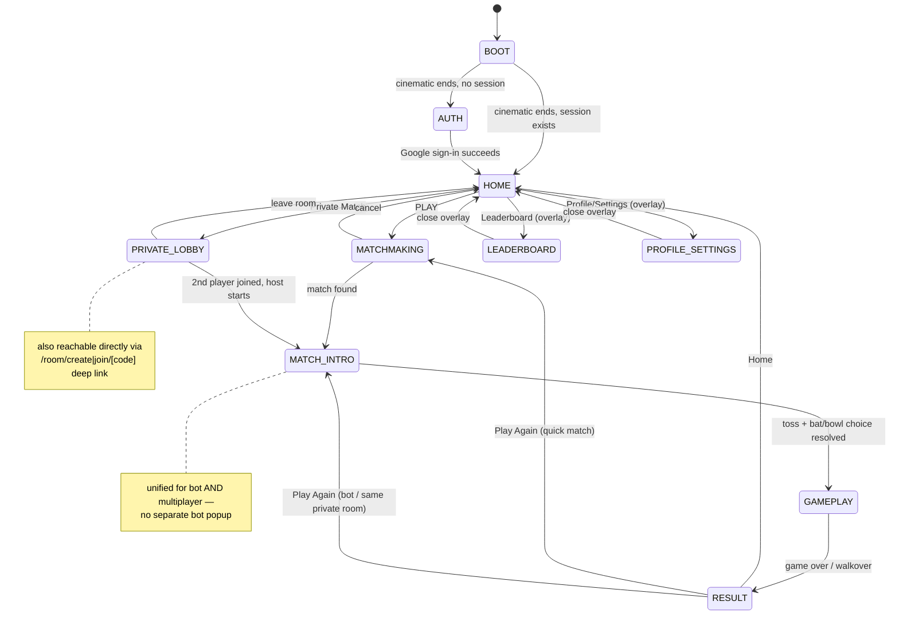

# THUMBBAT — Game Client Architecture (Frontend Reset)

**Status: PLANNING ONLY. No code has been written against this document. Per explicit instruction, this stops here for review before any implementation begins.**

**Supersedes:** the incremental "Sprint 1–7" visual work documented in `THUMBBAT_UI_AUDIT.md`. That document remains as the historical record of the SaaS-derived UI and its component tree — useful for understanding *why* things are shaped the way they are, but it is no longer the target. Nothing in Sprints 1–7's presentation layer is assumed to survive this reset except where explicitly listed in Section 4.

**Everything backend-side, and everything in `docs/THUMBBAT_UI_AUDIT.md` Sections F–G (Socket.IO protocol, game rules, auth flow) is unchanged and remains the authoritative contract.** This document does not re-derive that analysis; it restates the parts the new frontend must not break.

---

## 1. Inspection summary — every existing screen/state, mapped to its replacement

| # | Current implementation | File(s) | New game state |
|---|---|---|---|
| 1 | Cinematic boot + Google sign-in | `src/app/page.tsx`, `components/boot/*` | `BOOT` → `AUTH` |
| 2 | `/login` fallback (username/password) | `src/app/login/page.tsx`, `components/auth/AuthOverlay.tsx` | `AUTH` (secondary path) |
| 3 | `/confirm` email confirmation | `src/app/confirm/*` | Not a game state — a one-time deep-linked utility page. Stays a plain page (see Section 4). |
| 4 | `/game` IDLE (title screen) | `components/game/home/GameHomeScreen.tsx` | `HOME` |
| 5 | Quick Match searching | inline in `GameHomeScreen` | `MATCHMAKING` |
| 6 | Private room create/join/waiting | `JoinRoomCard.tsx`, `RoomBanner.tsx` | `PRIVATE_LOBBY` |
| 7 | `/room/[intent]/[code]` (duplicate room+toss+board flow) | `room-route-client.tsx` | Folded into the same `PRIVATE_LOBBY` → `MATCH_INTRO` → `GAMEPLAY` states — **the long-flagged duplicate implementation goes away entirely**, see Section 5.2 |
| 8 | Toss call/result/bat-or-bowl | `TossOverlay.tsx` | `MATCH_INTRO` |
| 9 | Bot "Cricket Gods chose you" popup | inline in `GameScreen.tsx` | `MATCH_INTRO` (unified with multiplayer toss, not a separate bot-only popup) |
| 10 | Game board / move selection / hand reveal | `GameBoard.tsx`, `MoveSelection.tsx`, `GameMoveVisual.tsx`, `Scoreboard.tsx`, `OpponentMoveDisplay.tsx` | `GAMEPLAY` |
| 11 | Innings-change overlay | `InningsOverlay.tsx` | `GAMEPLAY` (an event moment, not a separate state) |
| 12 | Game over / walkover modal | `GameOverModal.tsx` | `RESULT` |
| 13 | `/leaderboard` | `src/app/leaderboard/page.tsx` | `LEADERBOARD` (in-shell overlay, not a page nav — see Section 5.3) |
| 14 | *(none — doesn't exist)* | — | `PROFILE_SETTINGS` — genuinely new surface, minimal scope (see Section 9) |

---

## 2. Backend dependency contract — must not change

This is the complete surface the new frontend is built *around*. Restated from the existing audit for this document's own completeness; the audit is still the deeper reference.

**Socket.IO — client → server:** `me:setName`, `me:setUser`, `queue:join`, `queue:leave`, `room:create`, `room:joinByCode`, `room:startGame`, `room:leave`, `toss:call`, `toss:choose`, `move:select`, `resume:join`

**Socket.IO — server → client:** `session:token`, `match:found`, `room:waiting`, `room:ready`, `room:timeout`, `room:exists`, `room:notFound`, `room:full`, `room:hostLeft`, `room:alreadyIn`, `room:error`, `toss:start`, `toss:result`, `toss:yourTurnToChoose`, `toss:opponentChoosing`, `toss:final`, `move:roundStart`, `move:roundResult`, `state:snapshot`, `state:pregame`, `resume:ok`, `resume:failed`, `session:replaced`, `opponent:left`, `game:walkover`

**REST APIs:** `POST /api/auth/login`, `POST /api/auth/signup`, `POST /api/auth/google`, `GET|POST /api/auth/confirm`, `GET /api/leaderboard`

**Auth contract:** JWT in `localStorage.token` + a mirrored `token` cookie (the cookie is what `src/middleware.ts` checks); `localStorage.username`/`userId`; the `login-success` window event; `useAuthGuard` client-side gating on `/game` and `/room/[intent]/[code]`.

**Server-authoritative game rules:** `finalizeRound()` in `server/socket-server.ts` (runs/wickets/innings-switch/chase-complete), matchmaking (`tryMatch()`, FIFO queue), private-room protocol (6-char codes, `ROOM_WAIT_MS`, host-only start), bot logic (`useBotGame.ts`'s client-side probability matrix — this one is frontend-owned but is explicitly *game logic*, not presentation, and is preserved unchanged).

**MongoDB models:** `User`, `Match`, `Score`, `VerificationToken` — untouched.

The new frontend's only job is to **present** state that these systems already produce. No new Socket.IO event, no new API route, no schema change is in scope for this reset.

---

## 3. What gets discarded

Every file below is presentation-only and is being treated as disposable, per your explicit instruction — including the Sprint 6/7 work built in this same engagement. None of these are deleted yet (that's a migration-plan step, done incrementally so nothing breaks mid-transition); this is the list of what the new architecture does not build on top of.

**Boot/auth presentation:** `components/boot/{BootSequence,CinematicLoader,GoogleSignInCTA}.tsx`, `components/auth/AuthOverlay.tsx`, `components/ui/GameViewport.tsx`

**Game/lobby presentation:** `components/game/GameShell.tsx`, `components/game/home/GameHomeScreen.tsx`, `components/game/lobby/*` (`QuickMatchCard`, `JoinRoomCard`, `SoloPracticeCard` — the latter two already dead-code/orphaned per the Sprint 6/7 audit notes), `components/game/room/RoomBanner.tsx`, `components/game/overlays/*` (`TossOverlay`, `InningsOverlay`, `GameOverModal`, `WaitingOverlay` — the last already dead), `components/game/board/*` (`GameBoard`, `GameMoveVisual`), `components/{MoveSelection,Scoreboard,OpponentMoveDisplay,GameMoveImages}.tsx` (the last three already dead per the original Sprint 0 audit), `src/app/room/[intent]/[code]/room-route-client.tsx`

**Sprint 6 visual-foundation primitives:** `components/game/visual/*` (`ArenaBackground`, `GestureIcon`, `GameScore`, `ResultCard`, `GameplayFeedback`) and `components/ui/{ArtSlot,assetContract}.ts` — these were a good-faith attempt at exactly this problem, but you're explicitly resetting the visual direction rather than iterating on them. Their *concepts* (asset-slot placeholders, a locked palette, a gesture-icon system) inform Section 7 below but the code is not reused verbatim.

**Website-era leftovers, already orphaned:** `components/Navbar.tsx`, `components/ui/Background.tsx`, `components/home/GamePreview.tsx`, `src/app/dev/visual-foundation/page.tsx`

**Generic UI kit (evaluate case-by-case during migration, not a blanket discard):** `components/ui/{Button,buttonStyles,Card,FormField,Snackbar,cx,motion}.ts(x)` — these are generic enough (a classname builder, a toast, a tiny `cx` helper) that some may survive as low-level utilities inside the new architecture even though the *visual identity* they currently express does not. Flagged as a judgment call for the migration phase, not decided here.

**Not discarded — kept exactly as pages, no game-state treatment needed:** `src/app/confirm/*` (a one-time transactional deep link, not part of the play loop) and the login/signup form's actual *logic* in `src/hooks/useAuthForm.ts` (the visual wrapper around it is discarded per above, the hook is not).

---

## 4. What survives untouched

- **Every hook that owns state or talks to the backend:** `useGameSocket.ts`, `useBotGame.ts`, `useAuthGuard.ts`, `useAuthForm.ts`, `useGoogleAuth.ts`. (`useCountdown.ts` is pre-existing dead code, unrelated to this reset.)
- **All of `server/**`**, all of `src/app/api/**`, `src/middleware.ts`, `src/env.ts`.
- **Raw assets:** `public/thumbbat-logo.png`, `public/media/loader.mp4` + `loader-poster.jpg` (the existing stadium cinematic — reusable as the `BOOT` state's asset and likely as a source/reference for the new art pipeline's arena renders).
- **The locked color palette's actual values** (Deep Indigo / Near-Black Blue / Mint / Cyan / Restrained Violet / Cricket-Ball Red) from `docs/design/ref.png` — that reference image is a product decision, not a piece of the disposable UI; the new architecture starts from the same palette unless you say otherwise.

---

## 5. New game-client architecture

### 5.1 One shell, layered composition

A single root component owns five stacked layers. Every game state renders into some subset of them rather than each state rebuilding its own page:

```
GameClientShell
├─ WorldLayer         (z-0)  fullscreen environment — video/image/particles, asset-slot driven
├─ HUDLayer           (z-10) persistent-but-unobtrusive chrome — score, identity, timer
├─ InteractionLayer   (z-20) the thing the player is actually touching right now
├─ OverlayLayer       (z-30) private-match sheet, leaderboard, settings — arena stays visible behind
└─ TransitionLayer    (z-40) full-screen wipes/fades between states
```

A state component (e.g. "Gameplay") doesn't render a `<div>` tree from scratch — it declares what belongs in `World`/`HUD`/`Interaction` for that moment, and the shell composites it. This is what makes "the arena remains visible behind the overlay" (Section: Private Match) structurally true instead of a styling convention someone can accidentally break later.

### 5.2 One state machine, derived from existing hooks — not reimplemented

```ts
type GameClientState =
  | "boot" | "auth"
  | "home"
  | "matchmaking"
  | "private_lobby"
  | "match_intro"
  | "gameplay"
  | "result"
  | "leaderboard"       // overlay state, see 5.3
  | "profile_settings"; // overlay state, see 5.3
```

`boot`/`auth` happen at `/` (unchanged route, new visuals only). Everything from `home` onward mounts once, at `/game`, and **never fully unmounts/remounts on state changes** — `GameClientState` is a pure function of the exact same flags `useGameSocket()`/`useBotGame()` already expose:

| State | Derived from (unchanged hook output) |
|---|---|
| `home` | `!preGameInRoom && !gameStarted && !isBotMode && !searching && tossPhase === "idle"` |
| `matchmaking` | `searching === true` |
| `private_lobby` | `preGameInRoom === true` (room exists pre-toss), or the player opened the "Private Match" overlay from Home before a room exists |
| `match_intro` | `tossPhase !== "idle" && tossPhase !== "done" && !gameStarted` — **for both bot and multiplayer**, replacing the bot's separate "Cricket Gods" popup with the same toss sequence everyone sees |
| `gameplay` | `gameStarted \|\| isBotMode` |
| `result` | `isGameOver \|\| botGameOver` |

No new state variable is introduced for any of this — it's a mapping layer, same as `GameHomeScreen`'s `isIdle` check was in Sprint 7, just generalized to the whole loop instead of one branch.

**This is also where the long-flagged "two parallel implementations" risk (original audit, Section L.1) finally gets resolved**, not worked around: `/room/[intent]/[code]` stops being a second full page tree with its own `useGameSocket()` call and its own copy of the toss/board JSX. Instead:
- The URL `/room/create/[code]` / `/room/join/[code]` still exists (shareable links must keep working — real functional requirement, not a nice-to-have).
- Visiting it mounts the *same* `GameClientShell` at `/game`'s state-machine, just initialized so the machine starts in `private_lobby` for that code instead of `home`. One component tree, one `useGameSocket()` call, reachable via two entry points.

### 5.3 Leaderboard and Profile/Settings are overlays, not page navigations

Right now, checking the leaderboard is a full Next.js route change — the entire `/game` tree unmounts, a new page mounts, and mounts again when you go back. That's the single biggest remaining "this is a website" tell once Home/Matchmaking/Gameplay/Result are rebuilt. Proposal: `leaderboard` and `profile_settings` become `OverlayLayer` states reachable from `HOME` (and from the in-gameplay pause/menu, if one exists later) without leaving `/game` or losing the arena underneath. The `/leaderboard` URL can still exist as a thin redirect/deep-link that boots straight into that overlay state, for anyone with the old link bookmarked — but it is no longer the primary way the state is reached.

*(This is the one architectural call in this document I'd flag as worth your explicit sign-off rather than assuming — it's a bigger change than "restyle this screen," since it changes routing, not just visuals. Everything else in Section 5 is close to how Sprint 7 already worked and is lower-risk.)*

### 5.4 Asset-slot system (generalized from Sprint 6's `ArtSlot`)

A single generic primitive, not five bespoke ones:

```ts
type AssetKind = "image" | "video" | "lottie" | "sprite-sheet";
interface AssetSlotSpec {
  kind: AssetKind;
  src?: string;              // absent = placeholder, never a fake asset
  aspect: number;             // reserved space, no CLS regardless of src presence
  poster?: string;            // for video kind
  resolutions?: { mobile?: string; desktop?: string }; // responsive swap
}
```

Every visual in Section 7's manifest is one of these. Swapping a CSS-generated placeholder gesture icon for a real AI-generated sprite later is a data change (fill in `src`), never a layout or component-tree change — this is the literal requirement from your "Art Pipeline" section, generalized so it isn't five different one-off components again.

---

## 6. State-flow diagram



---

## 7. Asset manifest

| Slot | Kind(s) | Used in state(s) | Notes |
|---|---|---|---|
| `bootCinematic` | video | BOOT | **Already exists** (`public/media/loader.mp4`) — reused, not regenerated |
| `arenaHome` | image or video | HOME | Full-bleed, portrait-first crop + desktop crop |
| `arenaMatchmaking` | video or lottie | MATCHMAKING | Needs a sense of motion/searching — a loop, not a still |
| `arenaMatchIntro` | video or image | MATCH_INTRO | Can reuse/derive from `arenaHome` if a dedicated render isn't produced |
| `arenaGameplay` | image | GAMEPLAY | Must stay legible under HUD/controls — likely darker/simpler than Home's hero shot |
| `arenaVictory` / `arenaDefeat` | image or video | RESULT | Two distinct moods, win vs. loss |
| `characterPlayer` / `characterOpponent` | image (transparent) | HOME, MATCH_INTRO, GAMEPLAY, RESULT | Generic "you"/"opponent" skins, not literal user photos — same framing as Sprint 6's decision |
| `cricketBall` | image or lottie | GAMEPLAY, transitions, branding accents | Small but load-bearing — appears in the reference moodboard repeatedly |
| `gesture1`…`gesture6` | sprite-sheet or lottie (per state: default/hover/selected/revealed) | GAMEPLAY | The single most identity-critical asset set — "core THUMBBAT identity asset" per your own framing |
| `effectFour` / `effectSix` / `effectOut` / `effectCritical` | lottie or sprite | GAMEPLAY | Short-lived event feedback, layered over HUD, not permanent |
| `transitionWipe` | video or lottie | between every state | One reusable transition asset is enough to start; state-specific ones are a later refinement, not a blocker |

Until each asset exists, its slot renders a neutral placeholder (a soft gradient shape, never a fake illustrated stand-in) at the exact reserved aspect ratio — same principle Sprint 6 established, now applied uniformly.

---

## 8. Migration plan

Phased and incremental, each phase independently shippable/testable against the existing backend — same discipline as the sprint process so far, deliberately renamed to "Phase" rather than "Sprint N+1" so nothing implies continuity with the discarded component hierarchy.

1. **Phase 1 — Shell + state machine, no visuals yet.** Build `GameClientShell`, the layer components (empty/placeholder), and the `GameClientState` derivation layer wired to the real `useGameSocket()`/`useBotGame()` output. Verify by logging/displaying the current state name only — proves the machine tracks reality correctly before any art is built on top of it.
2. **Phase 2 — Boot + Home.** New cinematic-boot treatment (can reuse the existing video initially) and the Home state, using placeholder asset slots. This is the first visually-judgeable milestone.
3. **Phase 3 — Matchmaking + Private Lobby**, including the `/room/[intent]/[code]` consolidation (Section 5.2) — the highest-regression-risk phase, tested against real create/join flows in both browser tabs.
4. **Phase 4 — Match Intro (unified toss).** Replaces both `TossOverlay` and the bot's separate popup with one sequence.
5. **Phase 5 — Gameplay**, including the gesture-control system and event feedback (FOUR!/OUT!/etc., wiring the server's already-unused `outcome` field for the first time).
6. **Phase 6 — Result**, including Play Again routing back into Matchmaking or Match Intro correctly depending on how the match was entered.
7. **Phase 7 — Leaderboard/Profile as overlays** (contingent on your Section 5.3 sign-off), plus the actual Profile/Settings surface's minimal scope.
8. **Phase 8 — Asset swap-in.** As the AI art pipeline produces real assets, drop them into the manifest slots — by design, zero layout/logic changes required.
9. **Phase 9 — Cleanup.** Delete the Section 3 discard list once nothing references it, delete `components/game/lobby/{QuickMatchCard,SoloPracticeCard}.tsx` and `components/game/overlays/WaitingOverlay.tsx` (already dead before this reset), archive or delete `THUMBBAT_UI_AUDIT.md`'s superseded sections (recommend keeping the file for history rather than deleting).

Each phase gets its own `docs/` entry (a new log, not appended to `THUMBBAT_UI_AUDIT.md`) documenting what shipped, verification performed, and known limitations — same rigor as every prior sprint, new document so it isn't mixed with the superseded era.

---

## 9. Open items needing your input before Phase 1 starts

1. **Section 5.3 — leaderboard/profile as in-shell overlays vs. real page routes.** Recommended, but it's a routing change, not just a visual one — flagging explicitly.
2. **Profile/Settings scope.** No settings feature exists anywhere in this codebase today (flagged in the Sprint 7 writeup too). This document assumes "minimal" — what should actually be in it (even just: username, sign-out, nothing else) needs a real answer before Phase 7, not invented.
3. **Palette carryover (Section 4).** Assumed the Deep Indigo/Mint/Cyan/Violet/Ball-Red values survive since they came from your own reference image, not from the disposable UI. Say so if that's wrong.
4. **Art pipeline timing.** Every phase above can proceed with placeholders per Section 5.4/7, but Phase 5 (Gameplay) and Phase 6 (Result) are the ones where placeholder-only will feel thin the longest — worth knowing roughly when real gesture/character/victory assets might land, so those phases can be sequenced accordingly.

---

**STOP — no implementation has begun. Waiting for review/approval of this architecture before Phase 1.**
